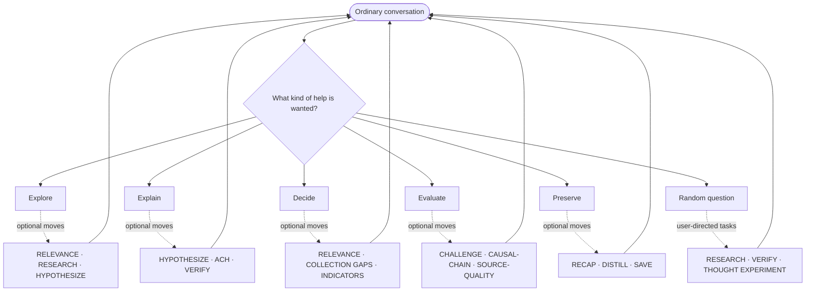
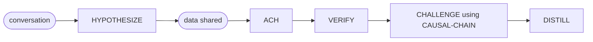
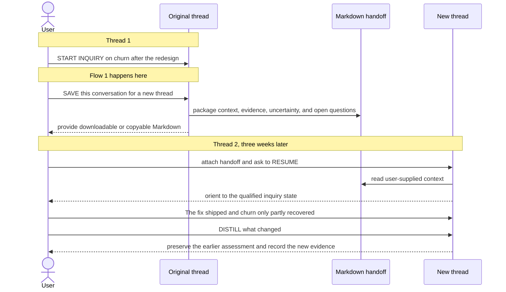

# Sample flows

These are examples, not workflows. A pathway names the kind of inquiry taking
place and the moves that may help; the user can skip, reorder, branch, stop, or
return to ordinary conversation at any point. Ask Dialectical for `flows` to
display the generic pathways in chat; ask for `cookbook` when you want practical
situations instead. Displaying either reference does not run an operation. The
data in worked examples is invented.

## Generic pathways

The same small set of pathways covers most conversations. They are menus of
possible moves, not stages to complete.

| Pathway | Start with | Possible moves | Useful ending |
|---|---|---|---|
| **Explore** | An idea, question, or connection that is not yet a decision | Clarify purpose with RELEVANCE, connect prior art with RESEARCH, generate alternatives with HYPOTHESIZE, and expose implications with a THOUGHT EXPERIMENT | A clearer question, promising possibilities, and open questions |
| **Explain** | An observation or outcome that needs an account | Separate observation from interpretation, generate competing explanations, compare them with ACH, identify missing evidence with COLLECTION GAPS, and check a specific link with VERIFY | A calibrated explanation, unresolved alternatives, and the next useful check |
| **Decide** | A choice with goals, constraints, and uncertainty | Clarify what the decision is for, distinguish values from empirical claims, prioritize consequential COLLECTION GAPS, and define INDICATORS for reconsideration | A decision with stated trade-offs and conditions for revisiting it |
| **Evaluate** | A claim, source, plan, or causal argument | RESTATE the object, assess SOURCE-QUALITY, inspect a CAUSAL-CHAIN, CHALLENGE assumptions, and VERIFY an empirical proposition | A scoped judgment that keeps evidence, inference, and uncertainty distinct |
| **Preserve** | A long inquiry whose state is becoming difficult to hold | RECAP what was discussed, DISTILL what was learned, TRACE how the position changed, CHECKPOINT the current state, and SAVE a reusable Markdown handoff | A portable record that preserves provenance, uncertainty, and open questions |
| **Random question** | A curiosity whose purpose is still open | Talk normally first; use RELEVANCE only if the purpose matters, RESEARCH for prior art or facts, HYPOTHESIZE for possible explanations, THOUGHT EXPERIMENT for implications, and VERIFY for a specific factual claim | A satisfying answer, a sharper question, or a deliberate choice about what to investigate next |

The pathway can change as the conversation changes. An exploratory question can
become a decision; an explanation can reveal a need for research; a conclusion
can be reopened when an indicator changes. GUIDE can rank three useful moves
when the user asks, but it does not choose or run a pathway automatically.

The diagram shows the relationship between ordinary conversation and the
pathways. It is a map of choices, not a process to complete.

## Flow 0: Following a random question

Random questions do not need to become formal inquiries. The conversation can
start with a plausible answer, then use an operation when the user wants a
specific kind of help. This example shows several independent tasks entering
one conversation; each handoff is requested by the user.

| # | User says | Operation | Result |
|---|---|---|---|
| 1 | “Why can a smell bring back a memory so suddenly?” | none | Ordinary conversation offers a few possible mechanisms, labels them as possibilities, and asks what the user is curious about: the biology, the personal experience, or something else. |
| 2 | “What explanations could account for that?” | HYPOTHESIZE | Generates competing explanations, such as associative learning, emotional salience, and attention, with observations that would distinguish them. It does not rank them or present the list as established fact. |
| 3 | “Find prior work that connects smell and memory, including disagreements.” | RESEARCH | Looks for relevant sources and prior art, reports what was actually found, and preserves source scope and uncertainty. Research is limited to this requested question. |
| 4 | “The answer said smell has a uniquely direct route to memory. Is that actually true?” | VERIFY | Checks that specific empirical proposition. If no evidence is available, it says verification is incomplete rather than treating the conversational claim as evidence. |
| 5 | “Suppose smell recognition were no better than recognition through another sense. What would that change?” | THOUGHT EXPERIMENT | Explores the implications of the counterfactual without claiming that the condition is true. |
| 6 | “What did we really learn?” | DISTILL | Separates findings supported by the retrieved evidence, explanations generated in conversation, unresolved disagreements, and the next open question. |

The user could stop after any row, return to ordinary conversation, or ask for a
different task. GUIDE is useful when the user wants help choosing the next move;
it does not activate because the question happens to be broad or interesting.

## Independent examples: purpose, gaps, and indicators

These are separate requests, not steps in one process.

| User says | Operation | Result |
|---|---|---|
| “RELEVANCE: I'm curious about why cities develop distinct identities. I'm not planning a policy.” | RELEVANCE | Frames an exploratory question about how shared practices and physical form contribute to identity, preserving curiosity as the purpose. Suggests that residents' experience and visitors' impressions may differ, without requiring a decision or audience. |
| “Churn rose after a redesign and a simultaneous price increase. We haven't compared cohorts; we asked for click logs, but they were deleted. What evidence is worth seeking?” | COLLECTION GAPS | Prioritizes churn comparisons by exposure to each change. Distinguishes the unexamined cohorts from unavailable logs; proposes support tickets as a limited proxy for usability problems without claiming to retrieve them. |
| “We think restoring export will help retention. What should we watch for?” | INDICATORS | Separates recovered export usage from later retention among affected customers, explaining that either alone is insufficient to establish causation. Leaves the observation window conditional on the retention cycle. No alerts or monitoring are created. |

## Choosing one move with GUIDE

GUIDE is requested when the user wants methodological advice. It does not stay
active after responding.

| User says | Result |
|---|---|
| “We have three explanations and a handful of observations, but we're just arguing about which story sounds best. GUIDE.” | Ranks ACH first because real alternatives and evidence are ready to compare, then offers two contextually useful alternatives and `[MORE]` for the full command catalog. It does not run any command. |
| “We're still freely exploring what makes a neighborhood feel distinctive. GUIDE.” | Ranks three optional commands suited to exploration and leaves the user free to ignore them and keep talking. |
| “Yes, use ACH.” | Runs ACH only. GUIDE does not add a second recommendation afterward unless invoked again. |

## Flow 1: Diagnosing an observation in one session

A product team's monthly churn rose from 3% to 5% after a March redesign. This flow uses one conversation and no memory store.

| # | User says | Operation | Result |
|---|---|---|---|
| 1 | "Churn went from 3% to 5% after the March redesign. What's going on?" | none | Ordinary discussion, with no menu of operations. |
| 2 | "HYPOTHESIZE." | HYPOTHESIZE | Four mechanisms, each with a prediction that would set it apart: the redesign hid the export feature; a price change shipped in the same release; a spring promotion brought in low-intent signups; the churn definition changed. No ranking. |
| 3 | Shares data: churn rose in cohorts that joined before the promotion; export-related support tickets doubled; churn rose as much on plans whose price didn't change; February churn was typical. | none | Discussion. |
| 4 | "Use ACH on these." | ACH | An evidence matrix. Export is least inconsistent. Price and promotion are each contradicted by one item. Regression to the mean is skipped because February was typical. Nothing in the evidence bears on the definition change, so its cells are `?`, and ACH names checking it as the next test instead of checking it itself. |
| 5 | "VERIFY whether the churn definition changed in March." | VERIFY | Refuted: the data dictionary and the dashboard's query history show no change since 2025. |
| 6 | "We'll restore the export button, and churn will go back to 3%. CHALLENGE that." | CHALLENGE, naming CAUSAL-CHAIN | Chain: restore button → users find export → frustrated users stay → churn returns to 3%. One linchpin: export explains most of the two-point rise. ACH showed export was the least inconsistent explanation, not that it explains the whole rise. Verdict: vulnerable, because the linchpin is unexamined. To settle it, compare the churn rise among users who exported before the redesign with everyone else. |
| 7 | "DISTILL." | DISTILL | Established: the churn definition did not change (VERIFY). Tested: export is the least inconsistent explanation, and price and promotion are contradicted (ACH). Uncertain: how much of the rise export explains. Next decision: ship the fix and measure. |

What this shows:

- **The conversation stays primary.** Two of the seven turns use no operation.
- **Handoffs are open.** ACH marks the definition question `?` rather than looking it up, and the user chooses to VERIFY it.
- **Methods are named.** CHALLENGE says that it is applying CAUSAL-CHAIN.
- **Consent follows scope.** Causal analysis inside the requested challenge needs no extra approval. Starting a new research objective or saving the result requires authorization; naming a method is not authorization.
- **The work is divided.** HYPOTHESIZE generates explanations, ACH weighs them, and DISTILL keeps track of where each conclusion came from.

## Flow 2: Carrying an inquiry into a new thread

SAVE produces a portable Markdown handoff. A host may make it downloadable; if
not, Dialectical returns complete copyable Markdown and a filename. The user
then attaches or pastes that artifact in the new thread. No external store or
automatic cross-thread memory is required.

| # | User says | Operation | Result |
|---|---|---|---|
| 1 | "START INQUIRY on churn after the redesign." | START INQUIRY | Establishes the focus in the current thread. No storage is required. |
| | Flow 1 happens. | | The conversation develops evidence, hypotheses, and a qualified assessment. |
| 2 | "SAVE this conversation so I can continue it in a new thread." | SAVE | Produces `churn-after-redesign-handoff.md` containing the purpose, essential context, inspected evidence and sources, least-inconsistent explanation, unresolved magnitude, alternatives, and next questions. It is not a transcript. |
| | *Three weeks later, in a new thread* | | The user attaches or pastes the handoff. |
| 3 | "RESUME from this handoff." | RESUME | Uses only the supplied artifact, preserves its qualifications, and does not claim access to the original thread. |
| 4 | "The fix shipped two weeks ago. Churn fell to 4.2%, not 3%." | none | Adds new evidence without erasing the earlier assessment. |
| 5 | "DISTILL what changed." | DISTILL | Reports that export likely explained part rather than all of the rise, identifies the new evidence, retains the earlier scope, and names the remaining question. |

What this shows:

- **The handoff is sufficient context.** A fresh thread can understand where the
  inquiry stands without seeing the original transcript.
- **Qualifications survive.** “Least inconsistent” does not become “proved,”
  and later evidence can revise the assessment without erasing its history.
- **Transfer is explicit.** The user carries the artifact into the new thread;
  SAVE does not claim automatic recall.
- **No chats are created.** SAVE and RESUME do not create, reopen, or attach a
  platform conversation.
