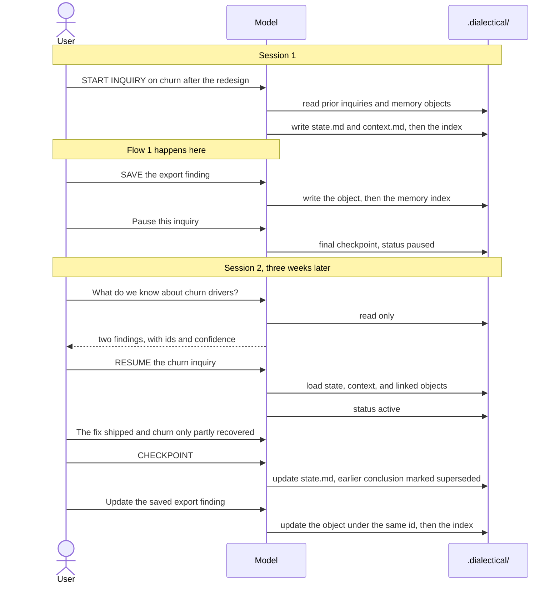

# Sample flows

Two illustrative sessions. They are examples, not workflows. Each operation happens because the user asked for it, and any of them could be skipped or reordered. The data is invented.

## Flow 1: Diagnosing an observation in one session

A product team's monthly churn rose from 3% to 5% after a March redesign. This flow uses one conversation and no memory store.

| # | User says | Operation | Result |
|---|---|---|---|
| 1 | "Churn went from 3% to 5% after the March redesign. What's going on?" | none | Ordinary discussion, with no menu of operations. |
| 2 | "HYPOTHESIZE." | HYPOTHESIZE | Four mechanisms, each with a prediction that would set it apart: the redesign hid the export feature; a price change shipped in the same release; a spring promotion brought in low-intent signups; the churn definition changed. No ranking. |
| 3 | Shares data: churn rose in cohorts that joined before the promotion; export-related support tickets doubled; churn rose as much on plans whose price didn't change; February churn was typical. | none | Discussion. |
| 4 | "Use ACH on these." | ACH | An evidence matrix. Export is least inconsistent. Price and promotion are each contradicted by one item. Regression to the mean is skipped because February was typical. Nothing in the evidence bears on the definition change, so its cells are `?`, and ACH names checking it as the next test instead of checking it itself. |
| 5 | "VERIFY whether the churn definition changed in March." | VERIFY | Refuted: the data dictionary and the dashboard's query history show no change since 2025. |
| 6 | "We'll restore the export button, and churn will go back to 3%. CHALLENGE that." | CHALLENGE, naming CAUSAL-CHAIN | Chain: restore button → users find export → frustrated users stay → churn returns to 3%. One linchpin: export explains most of the two-point rise. ACH showed export was the least inconsistent explanation, not that it explains the whole rise. Verdict: vulnerable, because the linchpin is unexamined. To settle it, compare the churn rise among users who exported before the redesign with everyone else. |
| 7 | "DISTILL." | DISTILL | Established: the churn definition did not change (VERIFY). Tested: export is the least inconsistent explanation, and price and promotion are contradicted (ACH). Uncertain: how much of the rise export explains. Next decision: ship the fix and measure. |

What this shows:

- **The conversation stays primary.** Two of the seven turns use no operation.
- **Handoffs are open.** ACH marks the definition question `?` rather than looking it up, and the user chooses to VERIFY it.
- **Methods are named.** CHALLENGE says that it is applying CAUSAL-CHAIN.
- **The work is divided.** HYPOTHESIZE generates explanations, ACH weighs them, and DISTILL keeps track of where each conclusion came from.

## Flow 2: Carrying an inquiry across sessions

The same churn investigation, run as a Dialectical inquiry so it survives between sessions. The workspace already has a `.dialectical/` store from an earlier pricing inquiry.

| # | User says | Operation | Store effect |
|---|---|---|---|
| 1 | "START INQUIRY on churn after the redesign." | START INQUIRY | Creates `conversations/2026-04-10-churn-after-redesign/` with `state.md` (status `active`) and `context.md`. The context carries forward a January finding, "annual-plan customers churn less, mostly through selection", with a link to its source. Then updates `conversations/index.md`. |
| | Flow 1 happens. | | None. |
| 2 | "SAVE the export finding." | SAVE | Writes `memory/objects/2026-04-10-export-discoverability-churn.md` with the finding, its basis (ACH, least inconsistent), and its limit (share of the rise unknown). Then rebuilds `memory/index.md` and links the object from `state.md`. |
| 3 | "Pause this inquiry." | CLOSE | Writes a final checkpoint to `state.md`, sets status `paused` with a status-history entry, then updates the index. Points out that "definition change ruled out" is unsaved, but does not save it unasked. |
| | *Three weeks later, in a new session* | | |
| 4 | "What do we know about churn drivers?" | RECALL | Read-only. Returns both findings with their ids and recorded confidence, and flags that the export finding predates the fix. |
| 5 | "RESUME the churn inquiry." | RESUME | Loads `state.md`, `context.md`, and the linked object. There is one match, so the request counts as the selection; it sets status `active` and records the change. With two similar titles, it would ask first. |
| 6 | "The fix shipped two weeks ago. Churn fell to 4.2%, not 3%." | none | None. |
| 7 | "CHECKPOINT." | CHECKPOINT | Updates `state.md`: export explains part of the rise, not most of it. The earlier conclusion stays, marked superseded along with the evidence that overturned it. New open question: what explains the remaining 1.2 points. |
| 8 | "Update the saved export finding." | SAVE | Updates the object under the same id, records what changed, then rebuilds the index. |

What this shows:

- **Records come before indexes.** Every canonical record is written before the index that points to it.
- **Retrieval doesn't change anything.** RECALL only reads. RESUME changes status only once the inquiry is selected.
- **Reversals are recorded, not overwritten.** The earlier conclusion stays recoverable.
- **Saving is explicit.** CLOSE flags the unsaved finding but leaves the decision to the user.
- **No chats are created.** Neither session claims to create or reopen a platform chat.

This is close to the end-to-end memory scenario in `QA/TEST_PLAN.md`, which adds a TAG step.
